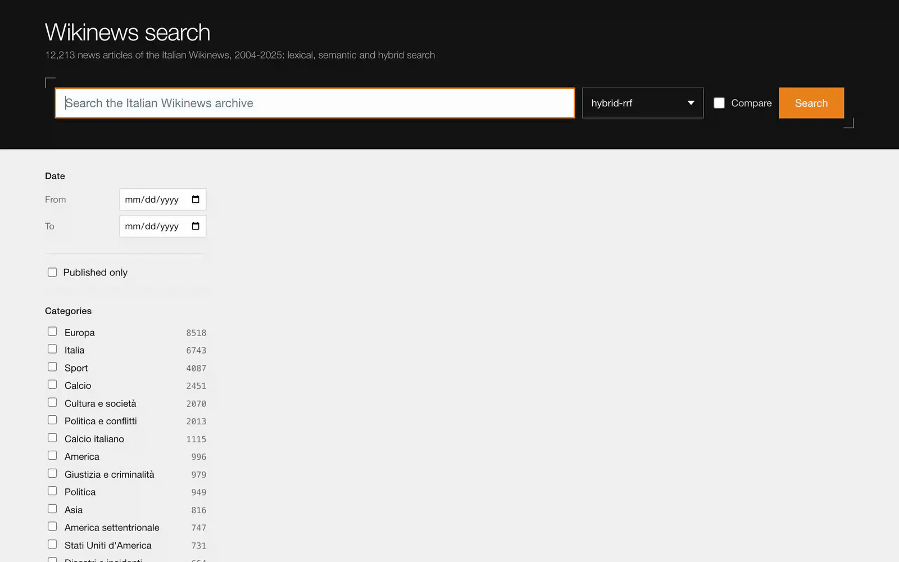

# wikinews-search

A search engine with a web interface over the Italian Wikinews news archive (about 12,000 pages,
2004-2025), built on Elasticsearch, with an evaluation of the design choices behind it.

Homework 4 of the Data Engineering course (Ingegneria dei Dati, Roma Tre, 2026/27) by
Gioia Buratti, Fabio Massimo Di Marco and Daniel Sadun.

Online demo: https://wikinews-search.denmarkeast.cloudapp.azure.com (how it is deployed:
`deploy/README.md`).



Final version for the delivery of 19 November 2026. The presentation is
`slides/wikinews-search.pptx`; every number in it comes from `results/summary.md` and can be
reproduced with one command (see "Evaluation"). How the work was split and planned: `PLAN.md`.

## What it does, in brief

1. **Data** (Daniel): the Wikinews dump of 20 March 2025, parsed into 12,213 documents. The news
   date, the sources and the categories are recovered from the wikitext templates, the text and
   the lead from the HTML; the titles of the cited sources are removed from the searchable text,
   because they are the queries of the test set (leakage).
2. **Retrieval** (Fabio): one `search()` function with eleven named configurations: BM25 with two
   text analyzers and different field weights, kNN on multilingual-e5-small embeddings, and a
   hybrid that fuses the two rankings with reciprocal rank fusion. A web interface with filters,
   facets and a side-by-side comparison of two configurations.
3. **Evaluation** (Gioia): two test sets, `fonti` (7,072 known-item queries built from the
   headlines of the cited sources) and `manual` (30 queries with graded judgments of a pooled set
   of 573 documents); standard metrics, bootstrap intervals, paired randomization tests with the
   Holm correction.

Main results (`results/summary.md`; p-values corrected with Holm):

| experiment | result |
|---|---|
| E1 Italian analyzer against standard | MRR@10 on `fonti` 0.743 -> 0.768 (p 0.0002), nDCG@10 on `manual` 0.648 -> 0.701 (p 0.038), and faster |
| E2 field weights | equal weights beat our title^3 lead^2 body: MRR@10 0.768 -> 0.800 (p 0.0006) |
| E3 lexical, semantic, hybrid | hybrid best: MRR@10 0.811 (BM25 0.768, kNN 0.781); on paraphrases 0.611 against 0.525 |
| E4 leakage | searchable sources would inflate MRR@10 from 0.768 to 0.900 |
| E5 boost of published pages | nDCG@10 0.804 -> 0.758 (p 0.029): not used |
| E6 cost | median latency 14.6 ms (BM25), 25.8 ms (kNN), 43.1 ms (hybrid) |
| E8 vector quantization | int8 and BBQ: no measurable loss of MRR@10, memory 19.2 -> 5.3 -> 1.2 MB |

Limits are stated with the results: `manual` has 30 queries, and 20 of them were graded by a
language model following the same guidelines (the agreement is measured on the 10 queries judged
by two people).

## Requirements

1. Docker Desktop (Elasticsearch runs in a container with a 1 GB heap; give Docker at least 3 GB
   of memory). On Windows Docker Desktop needs WSL 2.
2. [uv](https://docs.astral.sh/uv/): it installs Python 3.12 by itself.
3. git.
4. About 5 GB of free disk for the Docker image, the dump, the index and the embedding model.

Checked on 18 November 2026 from a fresh clone on macOS, following this README: `uv sync`; the
parsing of the dump, which gives a `docs.jsonl` identical byte for byte to the one the results
were computed on; the indexing (two indices in 38 s); the full test suite (130 tests, 108 of them
also without Elasticsearch); search from the command line and the web app; and
`evaluation.run --configs bm25-italian knn`, which gives the same metrics as
`results/summary.md` on both test sets (about 16 minutes, latency measurement included).

## Setup

```bash
git clone https://github.com/dnlsdn/wikinews-search.git
cd wikinews-search
uv sync
docker compose up -d
curl localhost:9200
```

Download the dump (73 MB) and extract it into `data/raw/`:

```bash
curl -L -o data/raw/itwikinews.tar.gz https://dumps.wikimedia.org/other/enterprise_html/runs/20250320/itwikinews-NS0-20250320-ENTERPRISE-HTML.json.tar.gz
tar -xzf data/raw/itwikinews.tar.gz -C data/raw
```

On Windows (PowerShell) use `curl.exe` instead of `curl`; `tar` is built in. The result must be
`data/raw/itwikinews_namespace_0_0.ndjson` (591 MB, 12,261 lines).

Elasticsearch takes about a minute to start the first time. `curl localhost:9200` must answer
with `"number" : "9.5.0"`; the container uses about 1.5 GB of memory. `docker compose down` stops
it and keeps the indices (they live in the `esdata` volume).

If it does not answer:

1. `docker logs --tail 30 wikinews-es`.
2. `read past EOF ... elasticsearch.keystore`: the container was created while the disk was full
   and its keystore is truncated. Free some disk, then `docker compose down` and
   `docker compose up -d` (this recreates the container; the data volume is kept).
3. Docker Desktop says "unable to start" with "no space left on device" in its logs: the disk is
   full. Free disk and restart Docker Desktop; on a Mac with 8 GB of RAM, swap also takes disk
   space, so close heavy applications.

## Usage

The order is: parse the dump, build the indices, then search (command line or web app) and run
the evaluation. Every command is the same in PowerShell.

### Data: parsing and indexing

```bash
uv run python -m wikisearch.ingest.parse
uv run python -m wikisearch.ingest.index
```

1. `parse` (about 15 s) reads `data/raw/itwikinews_namespace_0_0.ndjson` and writes
   `data/processed/docs.jsonl` (12,213 documents, not committed), the committed sample
   `data/sample/docs.sample.jsonl` and a coverage report `results/parse_report.json`. The fields
   are described in `docs/contracts.md`, section 1.
2. `index` builds the two indices `wikinews-standard` and `wikinews-italian` (same fields,
   different analyzer on the text fields) and loads the document vectors from `data/shared/`.
   Under a minute; every build appends its time and size to `results/indexing.csv`. Mapping in
   `docs/contracts.md`, section 2.
3. The vectors are committed (`data/shared/embeddings.npy`), so nobody needs to compute them.
   To recompute them: `uv run python -m wikisearch.ingest.embed` (about 2 minutes on a laptop CPU,
   plus 470 MB for the model the first time), then index again.
4. The extra indices for E8: `uv run python -m wikisearch.ingest.index --analyzers italian
   --vector-index int8_hnsw bbq_hnsw`.
5. The data report with the counts and examples used on the slides:
   `uv run python -m wikisearch.ingest.report` writes `results/data_report.md`.

To work on a small corpus first: `uv run python -m wikisearch.ingest.index --input
data/sample/docs.sample.jsonl`.

### Search and web app

Needs Elasticsearch running and the indices built (parsing and indexing above).

```bash
uv run uvicorn wikisearch.web.app:app
```

Then open http://localhost:8000. The first query of a vector configuration (`knn`, `hybrid-rrf`,
...) loads the embedding model, `intfloat/multilingual-e5-small`: about 25 s, and 471 MB of
download the very first time. Every later query takes well under a second.

What the interface does:

1. **Search** with a configuration chosen next to the search box. Each result shows title, date,
   a snippet with the query words highlighted, categories, source agencies and a "not published"
   label for pages that are not news articles (index pages, tables, drafts).
2. **Filters** in the left column: date range, categories and agencies (with counts for the
   current query), "published only". Every change reruns the search.
3. **Compare** two configurations side by side on the same query: tick "Compare" and pick the
   second one.
4. **Document view**: click a title for the full text, sources, linked Wikipedia entities and a
   link to the original Wikinews page.
5. The query, configurations and filters are kept in the URL, so a search can be shared as a
   link, e.g. http://localhost:8000/?q=terremoto+in+Abruzzo&config=bm25-italian&compare=1&config2=knn.
   The links of the live demo are in `docs/demo.md`.

Configurations (`wikisearch/search/configs.py`; each one is a variant of the experiments in
`PLAN.md`):

| configuration | what it does |
|---|---|
| `bm25-standard` | BM25 on title (weight 3), lead (2) and body, standard analyzer |
| `bm25-italian` | the same with the Italian analyzer (elision, stop words, light stemming) |
| `bm25-italian-title`, `-body`, `-flat` | title only, body only, three fields with equal weights |
| `bm25-italian-leak` | also searches the titles of the cited sources (only to measure leakage) |
| `knn` | nearest neighbours of the query embedding (e5-small, 384 dimensions, HNSW) |
| `knn-int8`, `knn-bbq` | the same on quantized vector indices (8-bit, binary); they need their own indices: `uv run python -m wikisearch.ingest.index --analyzers italian --vector-index int8_hnsw bbq_hnsw` |
| `hybrid-rrf` (default) | BM25 and kNN, 100 hits each, fused with reciprocal rank fusion (k = 60) |
| `hybrid-rrf-published` | the same, with published pages boosted by 1.5 |

From the command line, for quick checks:

```bash
uv run python -m wikisearch.search "terremoto abruzzo" --config bm25-italian
```

Without Elasticsearch, the web app can run on three fake results (used by the tests and to work
on the interface): `WIKISEARCH_FAKE=1 uv run uvicorn wikisearch.web.app:app` (PowerShell:
`$env:WIKISEARCH_FAKE=1; uv run uvicorn wikisearch.web.app:app`, then
`Remove-Item Env:WIKISEARCH_FAKE`).

The API used by the interface (`docs/contracts.md`, section 4): `/api/search`, `/api/doc/{id}`,
`/api/facets`, `/api/configs`.

### Evaluation

Every command below is the same in PowerShell. They need the parsed corpus
(`data/processed/docs.jsonl`); all but the first also need Elasticsearch and the indices.

**Test sets** (`evaluation/testsets/`, committed, so rebuilding them is only needed to check them):

1. `fonti`, known-item search: the query is the headline of an external source cited by an
   article, the only relevant document is the article. 7,072 queries, one per article, and a
   fixed subset of 1,000 (`queries_dev.tsv`, seed 42). Rebuild it and print the funnel, the
   overlap buckets and the leakage check with:

   ```bash
   uv run python -m evaluation.build_fonti
   ```

   `--show-language 50` also prints 50 titles dropped and 50 kept by the language rule, for an
   eye check.
2. `manual`: 30 queries written by the group (`queries.tsv`, each with its type and information
   need), the top 10 of the five configurations compared on it pooled and judged 0 / 1 / 2 by
   the three authors (`GUIDELINES.md`). The steps, in order:

   ```bash
   uv run python -m evaluation.pool
   uv run python -m evaluation.judge --judge <name>
   uv run python -m evaluation.merge_judgments
   ```

   `pool` writes one blind assignment file per judge in `judging/`; `judge` shows one document at
   a time and saves every grade at once in `judgments/<name>.tsv` (stop with `q`, resume later);
   `merge_judgments` computes Cohen's kappa on the queries judged twice (M01-M10), lists the
   disagreements and writes `qrels.txt`.

**Reproducing every number** (an estimated 20 minutes on a laptop; close other heavy applications, the
latencies depend on it):

```bash
uv run python -m evaluation.run
```

For every test set and configuration it searches each query (k = 100), writes the run to
`results/runs/` (not committed), and computes from the runs:

| file | content |
|---|---|
| `results/metrics/fonti.csv`, `manual.csv` | one row per configuration and the `random` baseline: MRR@10, R@10, R@100 (`fonti`, also per overlap bucket); P@10, nDCG@10, MAP, MRR@10 (`manual`); each with its 95% bootstrap interval |
| `results/metrics/<set>_per_query.csv` | the per-query scores behind the intervals and the tests |
| `results/metrics/significance.csv` | each comparison of the experiments E1-E5 (and E8): difference of the means, p-value of the paired randomization test, p-value corrected with Holm-Bonferroni within the experiment |
| `results/metrics/latency.csv` | query latency p50 / p95 per configuration (E6), measured on 500 `fonti` queries with the configurations in random order |
| `results/summary.md` | all the tables above, with the machine and the commit |

Seeds are fixed (42), so the same corpus and indices give the same numbers; latencies depend on
the machine. Options: `--dev` runs on the 1,000 dev queries of `fonti` and writes under
`results/runs/dev/` (a few minutes, for development); `--configs <name> ...` reruns only some
configurations and reuses the other runs; the `manual` set is skipped until `qrels.txt` exists;
the E8 configurations are skipped where their indices are not built.

After a run, two commands read the metric files without searching again:

```bash
uv run python -m evaluation.figures
uv run python -m evaluation.manual_human
```

`figures` draws the four figures in `results/figures/`; `manual_human` recomputes the `manual`
metrics and comparisons on the 10 queries judged by two people only
(`results/metrics/manual_human*.csv`), as a check that the conclusions hold without the grades
given by a model.

Tests of the metrics (hand-computed examples), the significance tests, the test-set builders and
the runner, all without Elasticsearch: `uv run pytest -q tests/test_metrics.py
tests/test_build_fonti.py tests/test_judging.py tests/test_merge_judgments.py tests/test_run.py`.

## Repository layout

| path | content |
|---|---|
| `wikisearch/ingest/` | parsing, embeddings, indexing, data report (Daniel) |
| `wikisearch/search/`, `wikisearch/web/` | `search()`, the configurations, the web app and its API (Fabio) |
| `evaluation/` | test sets, judging tools, metrics, significance tests, experiment runner, figures (Gioia) |
| `data/sample/`, `data/shared/` | a sample of the documents and the shared embeddings (the dump and the processed corpus are not committed) |
| `results/` | data report, indexing times, metrics, `summary.md`, figures, demo screenshots |
| `slides/` | the presentation (`wikinews-search.pptx`), the content of each part in Italian |
| `docs/` | contracts between the parts, what the course expects, the demo script |
| `tests/` | unit tests and contract tests (`uv run pytest -q`) |
| `PLAN.md` | the plan: split of the work, experiments, timeline |

